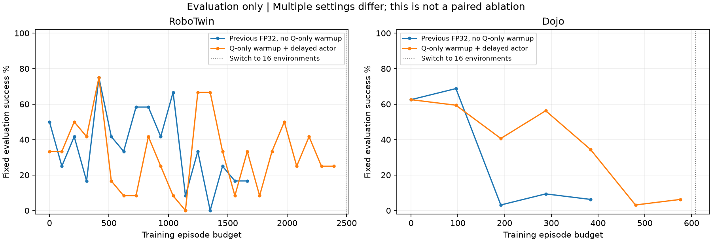
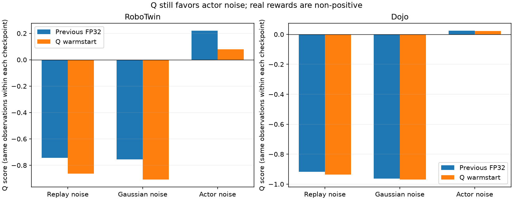

# DSRL训练诊断、RLT检查点修复与16环境试跑 · 2026-11-07

## 结论

两路DSRL已完成FP32和2000次Q-only预训练，仍有明显的噪声策略分布偏移及Q乐观偏差。RLT两路则是确定的工程错误：正式评估首次保存最佳小策略时，错误地读取DSRL的local_shard路径；RLT实际保存DCP和compact full_weights。两种问题不能混为一谈。

## DSRL：新旧版本与当前证据

|版本|已确认情况|解释范围|
|---|---|---|
|11/4旧BF16|小网络和Adam低精度，曾在真实回放更新测试中出现大量非零梯度参数不变|FP32修复必须保留；不能用旧平台期证明算法本身无效|
|11/5 FP32、±2|Dojo Clean固定评估20/32→22/32→1/32→3/32→2/32；旧Q同观测probe把策略噪声打到+0.024、回放噪声−0.918|能够更新，但学习效果退化；FP32/幅度曾一起改，不能各自归因|
|11/6 Q预训练、延迟actor|当前Dojo20/32→19/32→13/32→18/32→11/32→1/32→2/32；RT2多轮大幅震荡，无稳定提升|收集阈值、Q预热、actor频率同时改变，不能把退化推迟单独算成Q预热收益|

当前CPU只读检查点：RT2 CP299、Dojo CP72。严格加载线上小网络，96个等间隔回放观测，固定观察只替换输入噪声；没有在GPU重新执行这些动作。

|指标|RT2|Dojo|
|---|---:|---:|
|回放转换数|19823|7289|
|实际累计Q更新|359080|109100|
|Q-only预训练已完成|2000|2000|
|Q(回放噪声)|−0.864|−0.937|
|Q(当前策略噪声)|+0.080|+0.023|
|Q(高斯噪声)|−0.908|−0.970|
|当前策略噪声RMS|1.492|1.528|
|当前策略噪声绝对值>1.9占比|19.0%|22.9%|
|各噪声坐标跨96条样本的平均标准差|0.426|0.325|
|各坐标均值构成的向量RMS|1.409|1.476|

奖励仅−1/0、target不加熵，因此真实折扣回报上界为0。正Q是明确的上界偏差；策略与回放评分差约1，同时成功率低，支持“actor利用了Q在未验证噪声区域的错误乐观评分”。不等同于完成了全部动作的真实回报校准。

关键动态：Q预训练结束时回放Q约−8.06/−7.12，进入联合训练后逐渐接近−1，策略噪声评分接近0。说明“预热确实做了，但没有阻止策略改变噪声分布后的自举偏差”。Dojo首500条有23个成功终止，末500条只有5个；这是条目统计，不是episode成功率。

噪声整体均值接近0会掩盖另一个变化：许多坐标分别偏向正/负方向，跨样本变化反而变小。尤其Dojo每坐标平均标准差仅0.325，而坐标均值向量RMS达1.476。说明放宽到±2后，幅度变大但选出的噪声仍在集中；不能只看全体坐标均值近0，就认为它保持原独立高斯的探索形态。这是分布偏移证据，不单凭这一项断言策略完全忽略观察。

小网络及Adam一二阶矩均FP32；回放奖励/终止/continuation一致；折扣为0.999^20、0.999^50的FP32值。训练与评估均采样噪声；log_prob未重复乘1600。把策略噪声BF16量化再评分差约1e−5，不能解释约1的Q差距。回放容量25000尚未覆盖，首末500条顺序有效。当前检查没有独立重放每一张图像对应的物理时刻、终态next_obs或完整蒙特卡洛回报。

[官方采集与更新代码](https://github.com/nakamotoo/dsrl_pi0/blob/main/examples/train_utils_sim.py)同样使用`gamma ** query_freq`；成功轨迹最后一段奖励0且不bootstrap，失败轨迹奖励−1且保留bootstrap。因此本次没有把这两项误判成移植错误。当前DrQ随机平移也在worker中执行。Q的训练目标可近似理解为“这段−1，再加Q给下段策略的分数”；若下段新噪声被高估为0，回放Q接近−1可以与很小的TD loss同时出现，loss小不保证真实回报预测正确。

## 机制与参数依据

- 当前让小网络从主相机64×64和14维状态学习1600维噪声的价值；actor/Q各自从零学视觉编码器，MLP128×3、10Q取均值。不是复用大VLA的视觉理解。高维、稀疏成功及大量离线更新是联合风险，尚不能单因果归责。
- B256、UTD20意味着每新增转换进行20次批量更新；Q:actor=2:1。当前RT2约2万转换已做36万次Q更新。加大并行并不会自动修复这个比例。
- 原论文π0实验明确为避免1600维难学，将32维噪声沿50步重复；我们的π0.5重复/5组/10组筛查损害基座成功率，所以不能直接改回低维。128宽、10Q均值、UTD20和Aloha±2本身有原文依据，不能称为抄错；真正变化是采用了全1600维空间。[论文C.5与表11](https://arxiv.org/html/2506.15799v2#A3.SS5)
- [官方配置](https://github.com/nakamotoo/dsrl_pi0/blob/main/examples/scripts/run_aloha.sh)目标熵0，论文仿真表给−d/2；当前−800不是本任务已验证的最优值。α下降至约1e−6及负微分熵本身不是实现bug，但与噪声集中、幅度趋边界共同出现。
- [作者调参建议](https://github.com/ajwagen/dsrl#tips-for-hyperparameter-tuning)将噪声幅度、UTD列为关键，并指出DSRL-NA可利用动作空间Q改善样本效率。下一步优先减少更新强度（例如UTD20→5，作为算法实验而非等价加速），再考虑对原高斯的分布约束；不再优先增加Q-only次数。扩大Q网络/复用VLA特征和DSRL-NA属于更大改动。

补充检索得到三个有具体切口的参考，均未混进本次并行测试：

- [Robometer附录E.2](https://arxiv.org/html/2603.02115v2#A5.SS2)：DSRL使用DINOv2腕部特征、π0 VLM特征与本体状态，Transformer输出8×32各时刻不同的噪声，Q也按chunk建模。[作者策略学习代码](https://github.com/robometer/robometer-policy-learning)已公开。这支持后续考察“预训练表征＋有时序结构的噪声网络”；它的π0-DROID只有10步生成窗口，不能直接把8×32设置搬到当前50×32的π0.5。
- [RLT论文](https://arxiv.org/html/2604.23073v1)：复用VLA表征、参考动作输入和BC约束有消融支持，尤其去掉BC约束会明显退化。因此RLT相对当前DSRL值得试的原因，是更好的输入表征和保留基座动作的约束；它仍依赖Q，当前两路还没有训练后优势证据。论文对比DSRL仍是32维重复50次，不能直接替本地1600维设置背书。
- [WarmPrior-DSRL](https://github.com/sinnnj/WarmPrior-DSRL)：围绕上一动作块预测的先验均值学习残差，作者报告两项Robomimic任务改善；但它先训练了WarmPrior底座。不能仅在现有π0.5上把初始高斯换成上一段动作，就视为同一方法或等价加速。

## RLT：修复与验收

`rlt_training_entry.py:progress`原先在首次best eval分支加载`actor/local_shard_checkpoint/checkpoint_rank_0.pt[model]`。修为加载RLT已保存的`actor/model_state_dict/full_weights.pt`，使用weights_only=True；DCP仍用于完整续训。

原smoke设置val_check_interval=0，只验证保存/恢复，没有覆盖正式评估后的best导出，因而漏掉此错误。本次回归运行真实progress函数，覆盖首次0分、同分、提高成绩三个分支，使用没有local_shard的DCP布局。两路真实CP20亦已导出并检查有限值。

CP20状态：Dojo已收集1905转换、RT2 1258转换，累计episode均160，Stage2更新数均0；尚未达到2000转换阈值。首次小策略评估0分不是已学习策略退化的证据。新运行从CP20恢复模型、优化器、回放、训练计数与RNG，底座/token保持一致；仿真从新episode开始，不承诺恢复物理场景中间态。

13:01现场补验：RoboTwin RLT已到新CP30，固定评估4/12，完成6400次Q更新，回放2527条、累计320局。DCP存在；compact权重全部FP32且有限，2341684个浮点元素中2269721个相对CP20改变，最大绝对变化0.290。新最佳策略成功导出到`protected-eval/.../rt2-rlt-clean-g7/global_step_30`，因此本次已在正式流程实际走过原故障的“成绩提高→导出最佳策略”分支。权重变化和4/12仅说明恢复/学习流程在运行，不能证明优于原π0.5；Dojo当前仍在接管前学习，尚无新一轮固定评估。

## 每轮采样×2

8→16环境，不增加单局物理长度，不加无效显存占位。B256和UTD不变；训练样本量增加，因此SAC串行更新可能也增加。剩余episode预算保持：RLT从CP20后380×8改为190×16，结束global_step210；DSRL在下一完整点n切换，结束n+ceil((400−n)/2)。Dojo固定评估保持32局，由8×4改为16×2；RT2保持12局。

每局物理时长、动作转换、奖励/终止规则和更新/新增转换比例不变；并行数会改变随机数分配和每次策略同步前采样的局数，不承诺逐轨迹相同。RLT每轮1600次更新上限保留：16环境时最大新增宏转换RT2 160、Dojo224，对应800/1120次在线更新，低于上限；5000次初始学习预算仍可分多轮执行。后续同族曲线按实际累计episode/转换数对齐，不能将切换后的global_step继续乘8。

4/5先保持旧正式任务，CPU watcher等待新的完整检查点后调用已验收切卡流程，先注册替代和回退再停止精确owner；6/7从旧RLT真实任务交接到新RLT。只修改4–7卡相关任务，不重启共享Ray。状态、吞吐和峰值记录在同目录轻量证据中；不要仅根据显存数推断加速。

FQL汇合已更新到恢复任务。复核旧join代码发现它实际以“两路已释放”判断，包含失败释放；此前巡检把它描述为“仅正常完成才能接续”不准确，本次据源码纠正。更新的是准确任务依赖，没有静默改变这个历史调度策略。

## 13:10验收结果与保留决定

4–7均为真实正式任务，已从各自完整检查点恢复并完成16局采样/更新；5/6进入下一批原生物理交互。4卡从CP312到356，5卡从CP76到238，6/7从CP20到210；每路原计划总量仍3200局。首轮DSRL分别新增131/223条宏转换，计划并完成对应训练循环2620/4460次；Q-only完成计数仍2000，没有恢复后重复预热。RLT当前实际完成Q更新4800/7475次，Dojo仍未到5000次接管线。

|卡|任务|16环境已完成轮次|采样＋更新中位秒数，8→16|观测到的有效转换吞吐比|16环境GPU采样峰值|
|---|---|---:|---:|---:|---:|
|4|DSRL / RoboTwin|2|267 → 563|0.94×|47.3 GiB|
|5|DSRL / Dojo|1|897 → 1616|1.13×|46.0 GiB|
|6|RLT / Dojo|3|618 → 1227|0.99×|31.5 GiB|
|7|RLT / RoboTwin|12|379 → 296|2.43×|36.0 GiB|

这里的转换是一段动作执行后的有效回放条目。吞吐比按总新增转换/总核心耗时计算；核心耗时为采样＋更新＋权重同步，剔除评估和保存，未把相互包含的env/rollout时间重复相加。旧段取末10轮，新段取最近最多10个完整轮次；RLT7已完成12轮，表中耗时统计使用最近10轮。不是同权重、同seed的配对测试；RLT旧段未开始更新，新段跨过训练阈值，服务器其他任务负载也变化，数值只能作本次容量调整的现场观察。

**保留16环境作为本轮采样容量设置，不继续加到32。** RoboTwin RLT观察到明显吞吐收益；Dojo DSRL首轮小幅正向；Dojo RLT近似持平；RoboTwin DSRL两轮约慢6%，未证明加速。后两项不纳入“已验证加速项”，保留的作用是按本轮要求扩大每轮有效采样和并行容量，不是为了把显存数字填满。若后续仅按吞吐选配置，4/6应优先考虑退回8，而不是继续增并行。

显存是每3秒nvidia-smi采样到的整卡峰值，不是逐算子精确峰值。4卡从旧窗口41.6 GiB到47.3 GiB；5卡旧窗口46.8 GiB、本次约46.0 GiB，不能说四路显存都增加。大模型常驻参数不随环境数翻倍，所以数据量×2不会带来显存×2；不同阶段的缓存、仿真和模型占用也不同。

串行工作也有明确代价：RT2 DSRL更新约129→254秒，Dojo约217→380秒/轮。UTD不变时，每轮数据更多就需要更多更新；这里通过减少剩余轮数维持总采样预算，没有暗降UTD或增大学习batch来制造速度收益。两路Dojo的主要耗时仍在环境交互，RLT小网络更新约几十秒，继续优化SAC更新不能解决它的主要瓶颈。

保存/评估间隔按数据量近似折半，不承诺总评估次数逐个相等（RT2 DSRL原13轮改7轮且存在恢复相位）。每次评估的固定case预算保持Dojo32、RT2 12；训练组大小仍1，不改变组内样本语义。配置逐叶比较通过，差异仅在并行、相应预算/间隔、RPC和日志/恢复路径；B256、UTD、奖励、终止、动作长度及噪声参数都没改。

RLT新保护权重经CPU加载与CP30 compact逐元素一致、有限值检查通过：9,379,125字节。它还需要同一VLA特征底座和Stage1 token（约1.49 GB），不是独立完整大模型；这些依赖已一并写入保护清单，不能把token误当无用临时ckpt清理。续训仍依赖完整DCP、训练状态和回放。

本轮保留原有已验证的DSRL更新加速；未重新开启上一批无收益的RLT更新加速或未通过效果验证的渲染跳过。RLT修复回归、真实CP20导出、正式CP30评估/最佳导出、CPU同观察Q诊断、四路并行首轮、UTD与预算核对均已通过；不将这些工程验收写成算法学习有效。FQL汇合依赖和真实RLT回退随新owner登记，未改共享Ray或其他用户任务。

## 轻量证据与图

- `evidence/repair-parallel-20261107/replay-probe.json`：CPU严格加载、参数/优化器dtype、奖励与噪声Q对照。
- `export-test.json`、`real-export-test.json`：导出分支回归及真实两路CP20检查。
- `rlt-resume-verified.json`：CP30真实学习计数、权重变化、4/12及最佳导出。
- `parallel-result.json`、`parallel-table.md`：四路真实轮次、计时、采样峰值与预算。
- `final-audit.json`：完整配置差异、UTD参数及保护权重逐元素复核。
- `routes-verified.json`、`source-aligned.json`：当前路由/FQL依赖、服务器代码与发布内容对齐。
- `q-diagnosis.png`、`version-comparison.png`：Q评分对照及按实际采样预算对齐的固定评估曲线；历史版本变化不止一个，不能当单因素消融。

