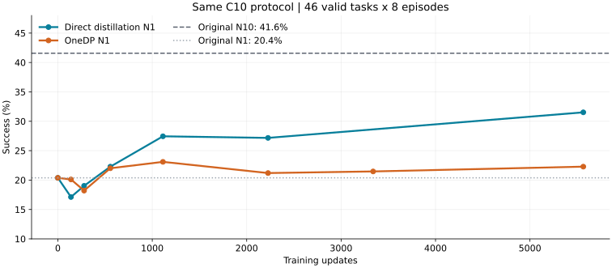
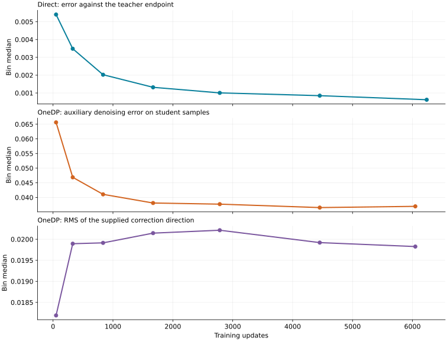

# 蒸馏范围与OneDP/DMD审计

快照：2026-10-26 11:59 +08:00。本轮核对实际部署源码、训练/评估记录及一手论文/实现；不改变正在运行的训练。

当前两方法训练全H50；C10只控制评估执行前缀。直接蒸馏损失只用真实14维，OneDP使用内部32维。5565步同协议结果：原始N1 **20.4%**，N10 **41.6%**，直接蒸馏 **31.5%**，OneDP **22.3%**。OneDP的收益被部分退步抵消，当前记录不能唯一定位原因。

[训练范围与来源](../../pi05_distillation/51_TRAINING_HORIZON_SOURCES_20261026.md) · [OneDP机制、实配与诊断](../../pi05_distillation/52_ONEDP_DMD_AUDIT_20261026.md) · [发布覆盖](../../pi05_distillation/53_RECENT_PUBLICATION_AUDIT_20261026.md)

`points.csv`为各点结果；`task-deltas-5565.csv`是逐任务变化；`analysis.json`保留配对计数、分段指标和源码核对结果。14条初始化重试在各条件一致，368请求回合对应367个唯一任务/实际种子。

`recent-light-snapshot.tar.gz`（11.8 MiB）补收C50/C10蒸馏、原始基线、Clean C扫描、Rand扫描、Dojo扫描/提速，以及GRPO τ1收束的轻量产物。内含逐回合结果、种子、配置、指标、耗时、错误及日志；原目录结构和清单在包内。大模拟器日志只收开头8KiB＋末尾64KiB，明确标注为excerpt；权重、数据、视频和密集控制/帧流留服务器，不混入轻量Git包。历史分支与Release核对见`publication-audit.json`。

核读的服务器源码副本位于包内`deployed-source`。`check-onedp-formula-cpu.py`是4项小张量公式检查，结果见`cpu-formula-check.json`，CUDA未初始化；它只验证梯度代数与隔离，不代替真实模型效果验证。`analyze-snapshot.py`可从归档重算分析数据。

2/3机故障后没有取回的新增产物仍是覆盖缺口，不能称三台全部归档完成。原有其他工作树的dirty保持不动。
