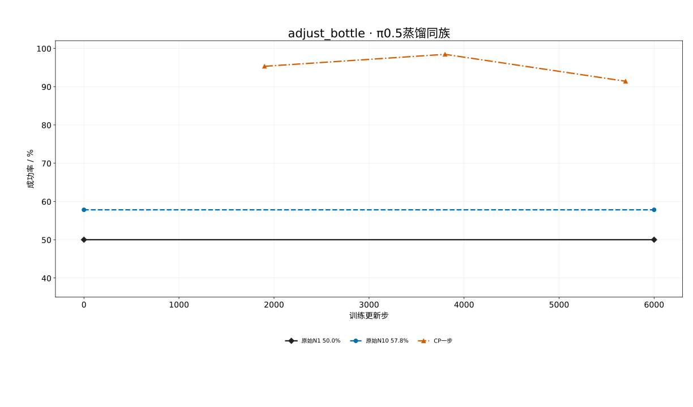
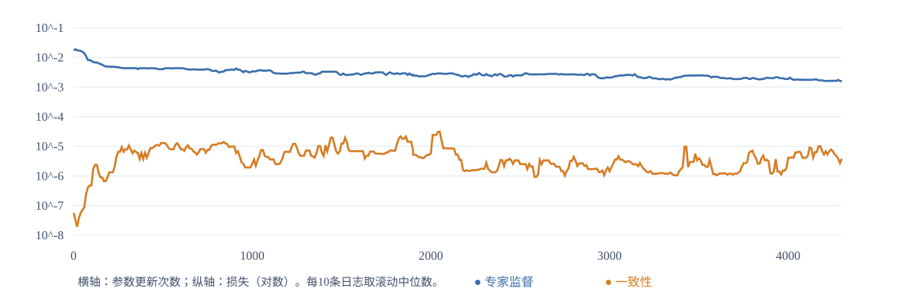

# adjust_bottle 蒸馏：2026-10-22中期评估

同128个RoboTwin初始种子、H50/C50、400动作上限、每卡32并行；原始N1 64/128=50.0%，原始N10 74/128=57.8%，CP1900 122/128=95.3%，CP3800 126/128=98.4%。实际种子无重试/替换，成功由模拟器原生标记判定。OneDP正式训练尚未开始，不能据smoke判断正式效果。

CP由原基座初始化，在50条官方调瓶子专家示范的4738个H50窗口上训练；当前每卡64、全局128，目标19000更新/500 epochs，每1900更新评128。CP同时使用老师指导的一致性和真实专家动作的原生FM监督，部署评估EMA动作专家；视觉语言前缀冻结。这里是π0.5流模型适配，不是原EDM/U-Net的逐项复现。

近期3810–4300更新FM中位数0.001791，一致性0.000004692，逐条二者比值中位数0.212%。不同损失的数值不可直接当作梯度贡献。尚无同数据同预算普通FM微调对照，不能把全部成功率提升归因蒸馏一致性项；单任务专项适配和过拟合也需新种子/其他任务测试区分。当前128种子重复用于开发评估，不是独立最终测试。

每1900更新保存完整可变训练状态（学生、EMA、优化器、各rank RNG、step、config），另存EMA动作专家推理覆盖文件；续训需要固定base、数据和源码。已保存CP1900与3800完整状态、256条CP完整视频、帧映射和控制动作材料，未随本包发布。该包仅含评估CSV、训练指标/配置和图，不含权重、回放、视频、账号/运维数据。

方法源码见本分支 `rlinf/algorithms/pi05_distillation/`、`tools/pi05_distillation/`；原始N1/N10与CP复用 `tools/pi05_policy_eval/run_batch.py`。参考：[CP论文](https://arxiv.org/html/2405.07503v2)、[CP官方实现](https://github.com/Aaditya-Prasad/consistency-policy/tree/eed0c465d3c1aa6dcf22f10e784df07dec06beac)、[OneDP论文](https://proceedings.mlr.press/v267/wang25ba.html)。
