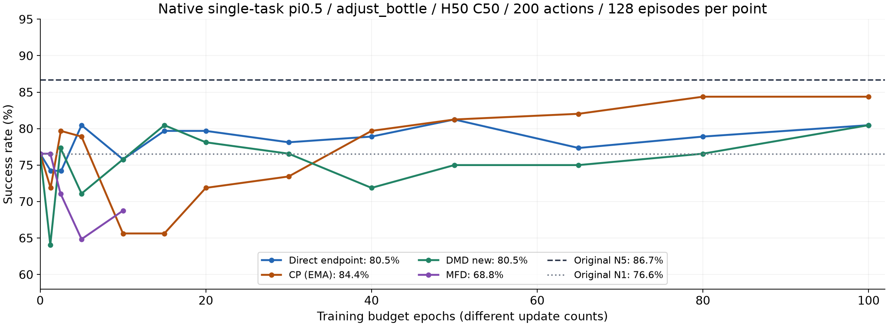
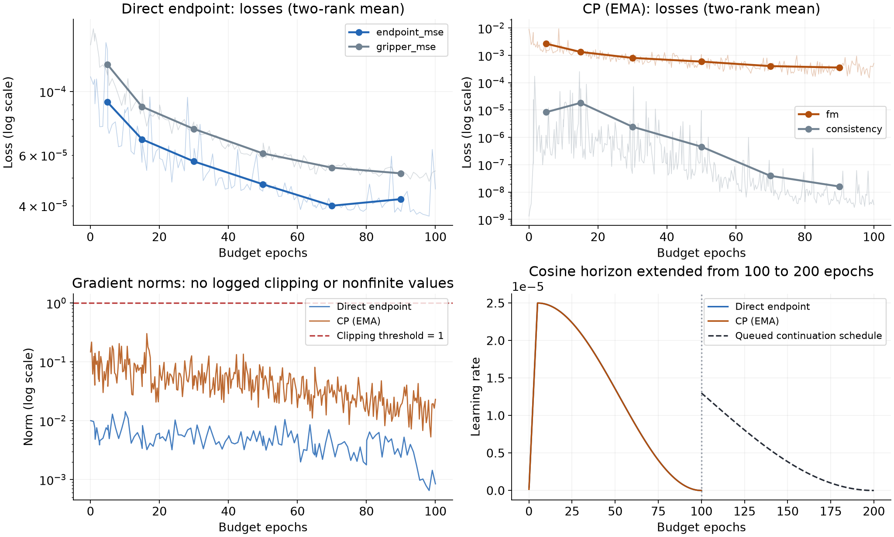
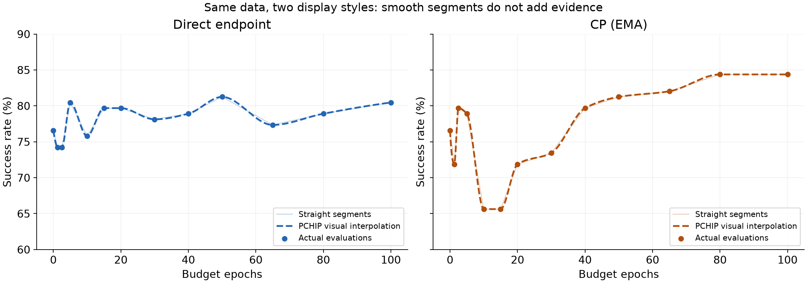

# 单任务直接蒸馏与CP：100轮审计及200轮续训

2026-10-28。原生adjust_bottle，N5老师/N1学生，H50/C50，200动作，每点128回合。直接末103/128、CP末108/128；DMD末103/128，MFD只到10轮处评估，不能当成最终成绩。

[完整分析和续训设置](../../small_flow_distillation/13_DIRECT_CP_EXTEND200_AUDIT_20261028.md)；[原始评估点](eval-points.csv)；[双卡均值训练信号](analysis-data.json)。SVG也一并保存。主曲线保留真实折线；PCHIP只在第三图做显示对照，不替换原始数值。

已接入等待队列：当前MFD→单任务FQL→Direct200→CP200→RLT。完整旧状态已核，12项CPU检查通过，扩展尚未开跑。GPU/图形绑定仍6/7，其他任务不改。
