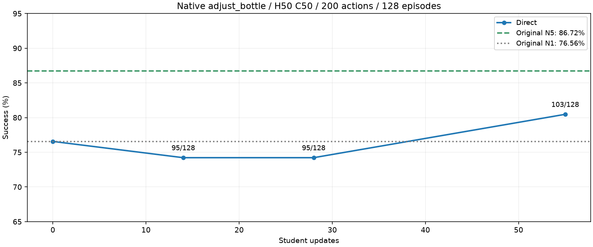

# Single-task distillation: first three formal evaluations

Snapshot: 2026-10-27 23:03 CST. Native RLinf adjust_bottle pi0.5, H50/C50, 200-action limit, held-out 128 episodes per point. Original N1: 98/128; original N5: 111/128.

Direct endpoint distillation completed 14, 28, and 55 updates with 95/128, 95/128, and 103/128 successes. Step 110 evaluation was still incomplete and is excluded from the curve. This early result is five successes above original N1 at step 55; it does not establish convergence.

The CSV also preserves the separately labelled Sidney C10/C50 multitask families. Those use different checkpoints and evaluation protocols; do not pool them with the native single-task result. Historical C50 evaluations used 8 or 16 episodes per valid task, as shown by each denominator.

No training or queue settings changed in this refresh. The Q warmup discussion is in [topic 71](../../pi05_distillation/71_FQL_Q_WARMUP_MULTITASK_20261027.md). This lightweight package contains our experimental results only; infrastructure snapshots, model weights, replay, and videos are excluded.
