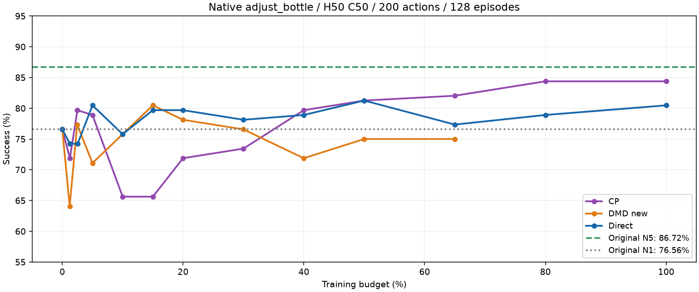

# Native single-task distillation: completed Direct and CP

Snapshot: 2026-10-28 10:01 CST. Native RLinf adjust_bottle pi0.5, H50/C50, 200-action limit, same 128 held-out episodes at each formal point. Original N1: 98/128 (76.56%); original N5: 111/128 (86.72%).

|Method|Completed evaluation points|Best|Latest|
|---|---:|---|---|
|Direct endpoint|12; training finished at 1100|104/128 at 550|103/128 at 1100|
|CP flow adaptation|12; training finished at 3000|108/128 at 2400 and 3000|108/128 at 3000|
|DMD new|10; training at 960/1300|103/128 at 195|96/128 at 845|

CP's final result is ten successes above original N1 and three below original N5. Direct's final result is five above N1. DMD new has not shown a sustained gain over N1. These are one fixed held-out seed set, not a multi-seed significance analysis. No method failed or was skipped; MFD and fixed-teacher FQL remain queued under the accepted plan.

Budget percentage normalizes Direct 1100, CP 3000, and DMD 1300 updates to 100%; it does not equate compute. [Actual update axis](native.png) and [all family points](points.csv) are also provided. Historical Sidney multitask C10/C50 rows are explicitly separate protocols, with their actual denominators.

Only self-owned lightweight results are included. No credentials, infrastructure snapshots, other-user information, weights, replay, or videos are published. Training settings were unchanged in this refresh.
