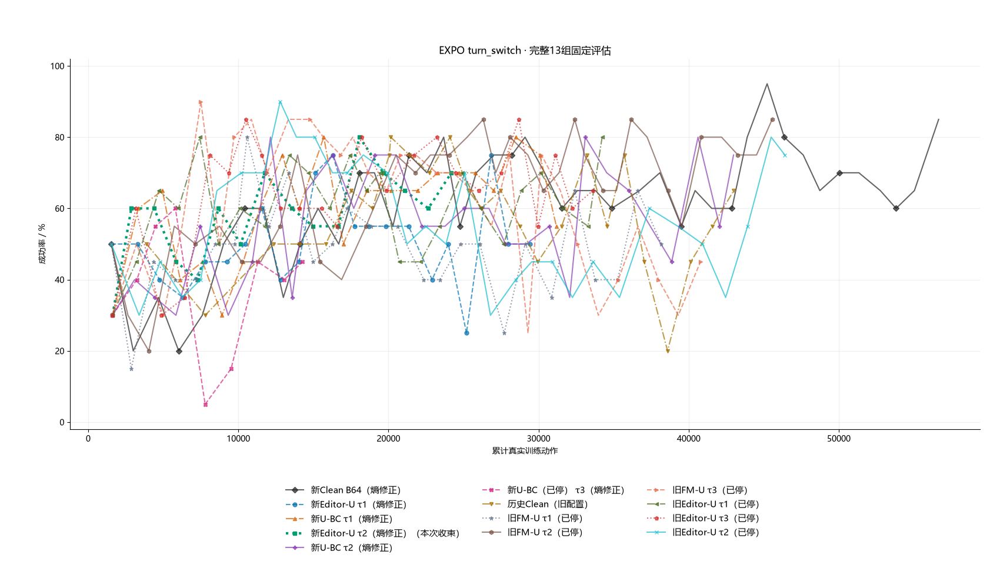

# Editor-U τ2（Clean熵修正）：提前收束

用户授权结束深圳2物理4/5本组，接VLABench π0.5官方全评估，再接原逐卡RLT。已由旧训练driver正常退出，并完成该组计算/图形清场；其他实验原样。

- 最后完整断点：24,568/60,000动作，162回合，568次更新；提前停止。
- 原始初评35%；最近完整评估70%；近5次均值69%；历史峰值80%。每点固定20回合。
- 相比原始模型有改善，但结果仍波动；按用户决定收束。本结果不足以得出等预算、独立种子的因果结论。
- 最后完整权重已另存protected-eval并登记；历史最高评估不能直接赋给未重评末代。没有上传或删除权重/回放。
- 原始配置、日志、评估和退出回执见primary-logs.tar.gz；绘图数据见evaluations.csv和family-curves.csv。

τ2更新至本次停止；其余12组沿用2026-10-19 21:50及已收束历史快照。预算与部分历史配置不同，曲线用于趋势比较。
