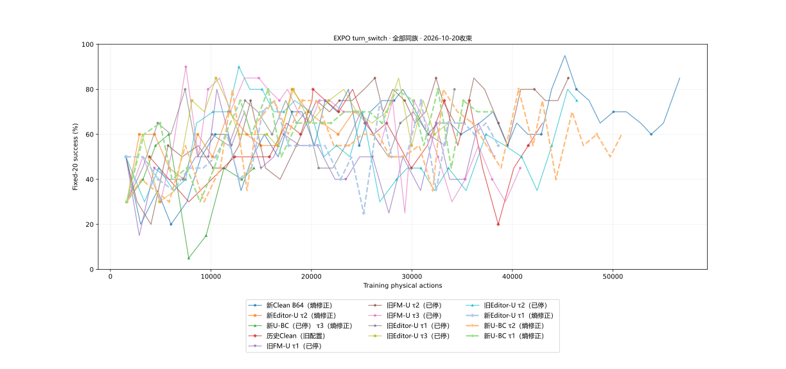

# 三组EXPO提前收束：2026-10-20

按用户决定停止三组turn_switch训练，保留最终完整恢复点、固定评估、曲线和轻量日志。三组均未跑完60,000动作预算。

| 主机 | 方法 | 已训练动作 | 初始 | 最新固定20 | 近5次均值 | 历史峰值 |
|---|---|---:|---:|---:|---:|---:|
| sz1 | 新Editor-U τ1（熵修正） | 39,314/60,000 | 40% | 55% | 62% | 75% |
| sz2 | 新U-BC τ2（熵修正） | 51,694/60,000 | 35% | 60% | 59% | 80% |
| sz3 | 新U-BC τ1（熵修正） | 38,118/60,000 | 35% | 70% | 68% | 80% |

U-BC τ1后段相对稳定；Editor-U τ1与U-BC τ2仍明显波动。三组均高于各自初始记录，但这不等于证明U加权优于Clean：训练预算不同、只有一个训练种子，固定20回合也较少。保留全同族曲线，供相同预算位置比较。

图保留13条历史/当前曲线，横轴为真实训练动作；本次三条更新至停止前，其他历史数据继承2026-10-20 10:36巡检快照。[逐点数据](family-curves.csv)可直接重画。单次历史峰值不等于最终权重表现。

三个主机子目录分别存closeout.json、evaluations.csv、released.json及light-evidence.tar.gz。归档包含配置、事件、评估结果与日志，不含权重、回放或视频。三个末代均另存服务器models/protected-eval/turn_switch/，登记工作区保护清单；没有把末代冒称峰值。

释放后启动[GRPO signed-U τ1/2/3](EXECUTION.md)，逐卡RLT仍为后续候补。
