# Attn成功轨迹精选

31任务、53条成功轨迹，每任务1–2条。完整本地图册含全程视频：[打开](http://127.0.0.1:8194/attn_objects1021/)。

蓝：直接读对象词；绿：视觉位置与对象词的关联重合；橙：两路相加。下方依次U、四噪声、DV。所有曲线是完整已执行前缀、逐动作原值，没有平滑或chunk平均。

原采集832/1600有效、494成功，48批报错或超时，19任务无完整数据。这里是从成功执行中挑例子，不是信号准确率评估。峰常带有动作位置效应，不能直接当成关键接触。原始完整视频和大数组留服务器，轻量图与映射可重画。

## A01 adjust_bottle · seed 100100005

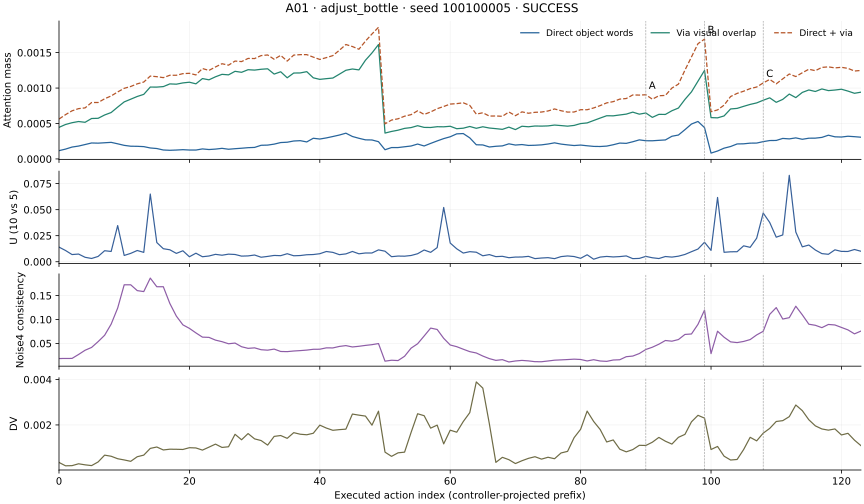

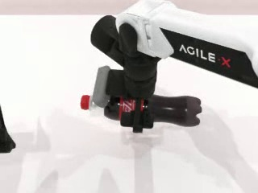

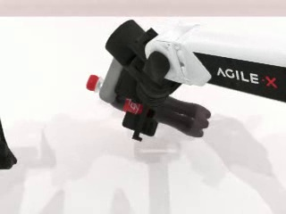

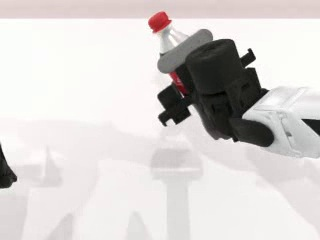

## A02 adjust_bottle · seed 100100007

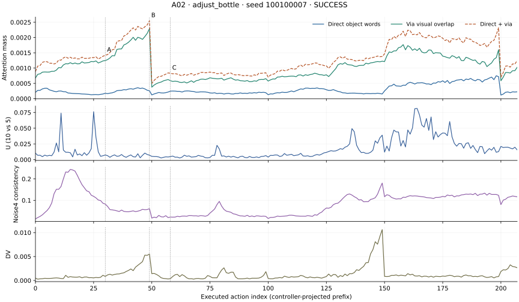

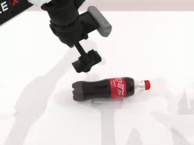

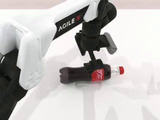

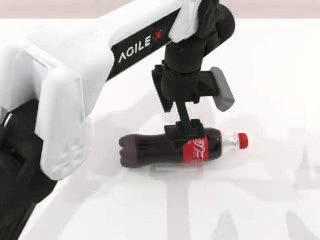

## A03 beat_block_hammer · seed 100150051

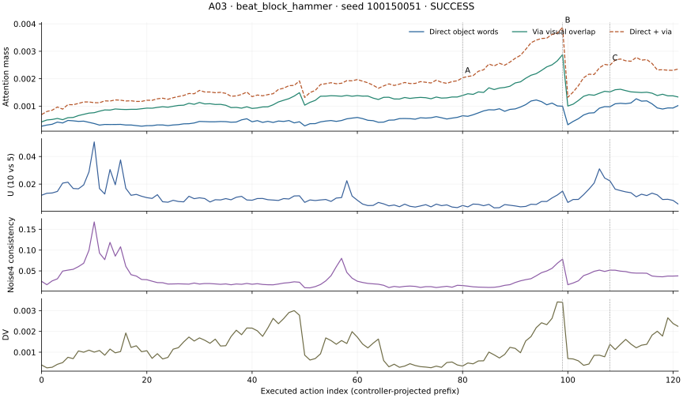

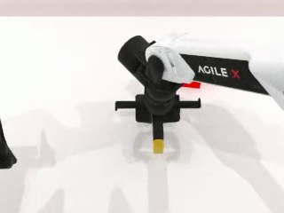

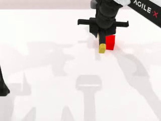

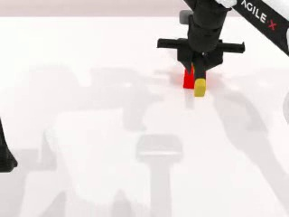

## A04 beat_block_hammer · seed 100150019

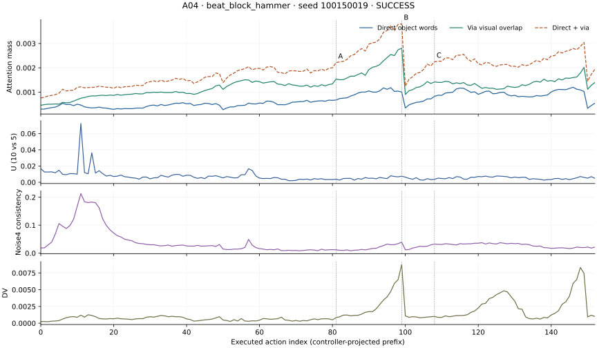

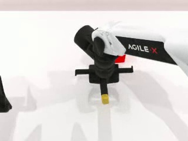

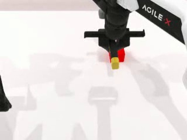

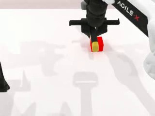

## A05 blocks_ranking_rgb · seed 100175024

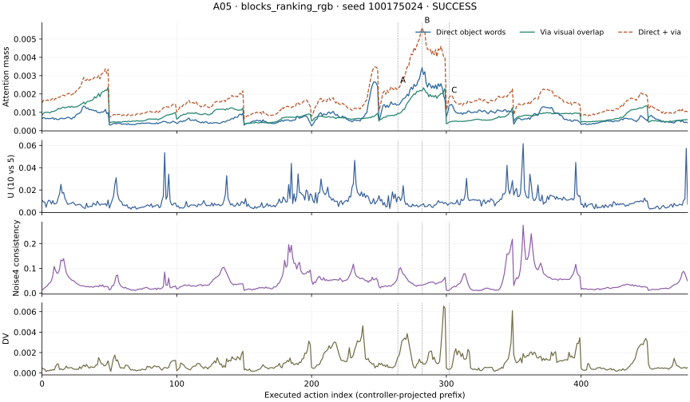

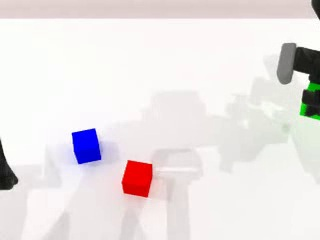

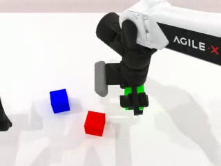

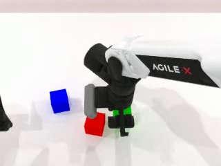

## A06 blocks_ranking_rgb · seed 100175009

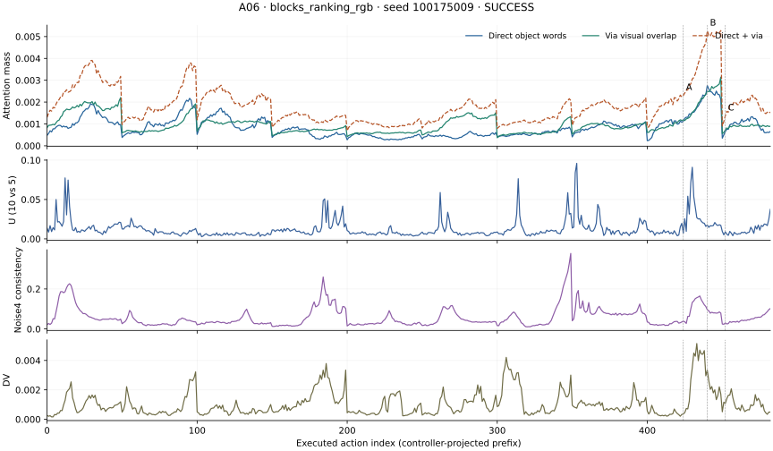

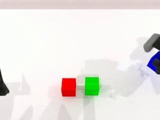

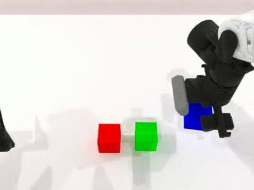

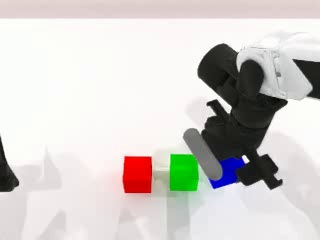

## A08 click_alarmclock · seed 140100

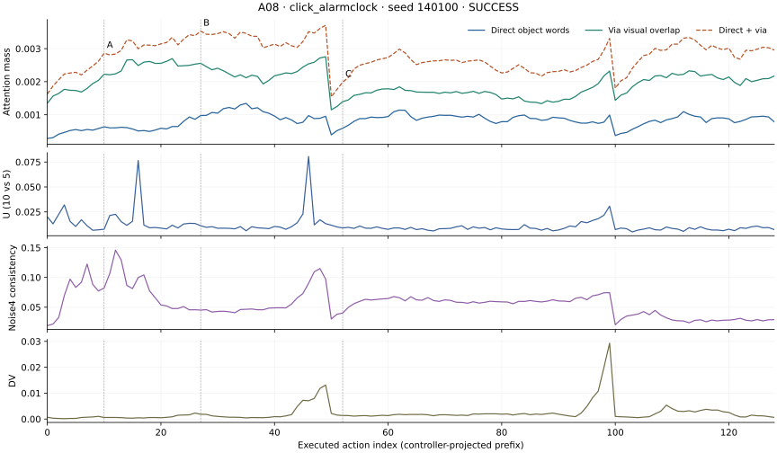

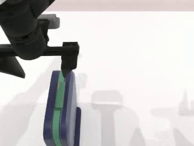

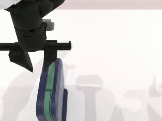

## A09 click_bell · seed 100100021

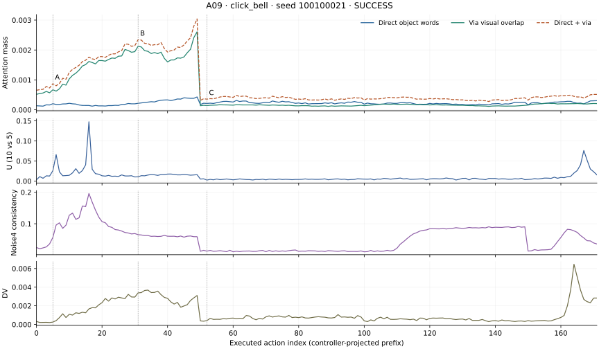

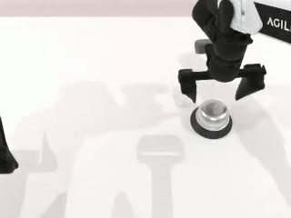

## A10 click_bell · seed 100100006

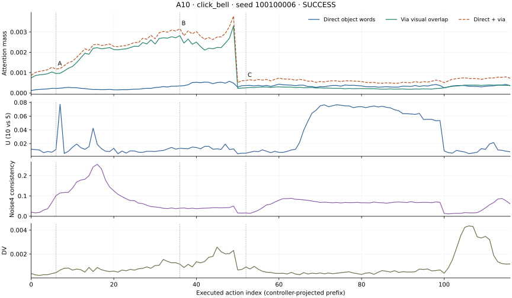

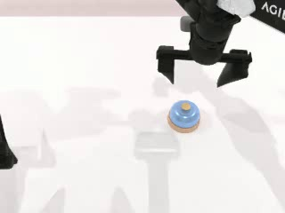

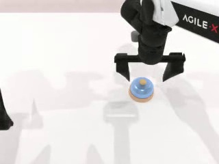

## A11 dump_bin_bigbin · seed 161902

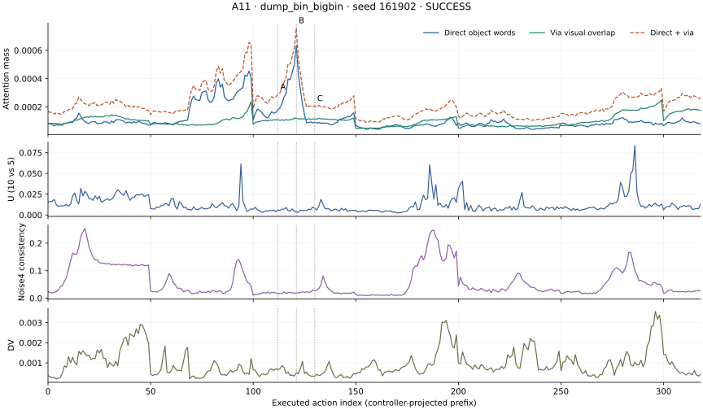

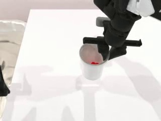

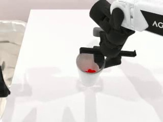

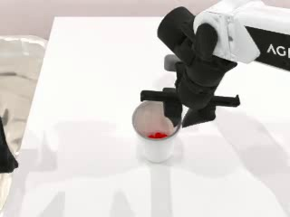

## A12 dump_bin_bigbin · seed 160004

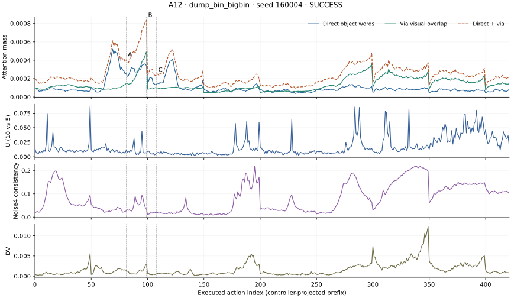

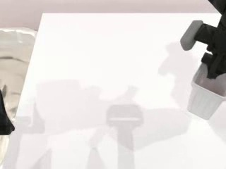

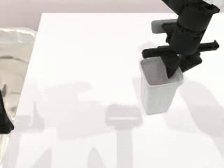

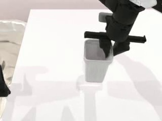

## A14 grab_roller · seed 170700

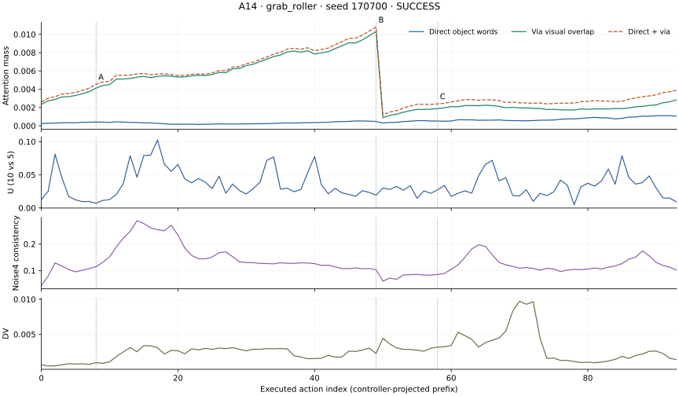

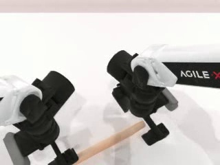

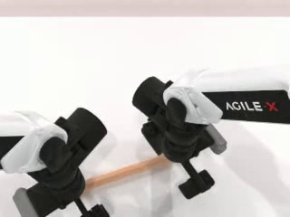

## A15 handover_block · seed 100100098

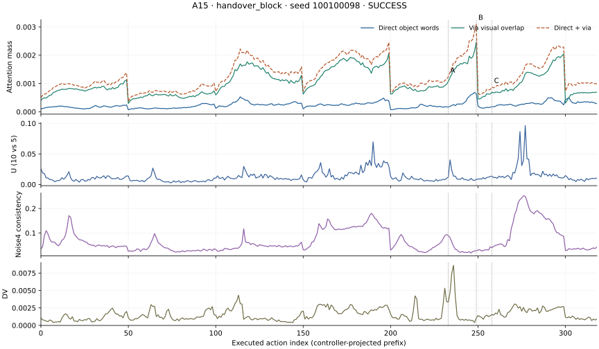

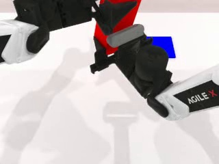

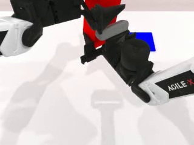

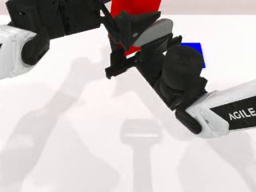

## A16 handover_block · seed 100100070

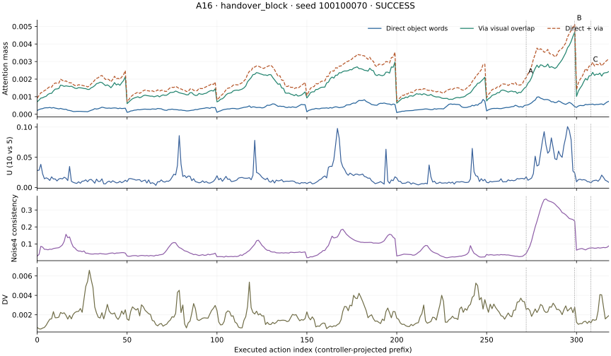

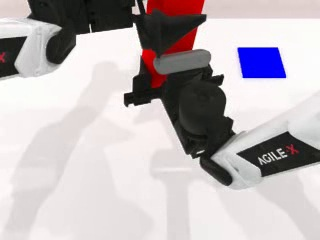

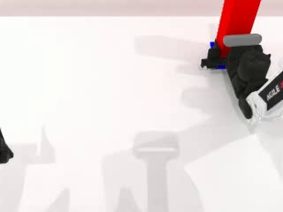

## A17 handover_mic · seed 100100026

## A18 handover_mic · seed 100100008

## A19 hanging_mug · seed 201800

## A21 lift_pot · seed 100100111

## A22 lift_pot · seed 100100058

## A24 move_can_pot · seed 100100039

## A25 move_pillbottle_pad · seed 100112514

## A26 move_pillbottle_pad · seed 100112502

## A27 move_playingcard_away · seed 241000

## A28 move_playingcard_away · seed 241800

## A29 open_laptop · seed 261800

## A30 open_laptop · seed 262800

## A32 open_microwave · seed 270700

## A33 pick_diverse_bottles · seed 282500

## A34 pick_diverse_bottles · seed 280900

## A36 pick_dual_bottles · seed 100100001

## A37 place_a2b_left · seed 100100040

## A38 place_a2b_left · seed 100100044

## A39 place_a2b_right · seed 100100026

## A40 place_a2b_right · seed 100100202

## A41 place_bread_basket · seed 320400

## A42 place_bread_basket · seed 320300

## A43 place_bread_skillet · seed 332400

## A45 place_burger_fries · seed 340000

## A47 place_can_basket · seed 351700

## A48 place_can_basket · seed 353000

## A49 place_object_stand · seed 442900

## A50 place_object_stand · seed 442000

## A51 press_stapler · seed 470500

## A52 press_stapler · seed 472900

## A54 rotate_qrcode · seed 501300

## A55 shake_bottle · seed 100100038

## A56 shake_bottle · seed 100100026

## A57 shake_bottle_horizontally · seed 532200

## A58 shake_bottle_horizontally · seed 532400

## A59 stamp_seal · seed 582300

## A60 stamp_seal · seed 582700

## A61 turn_switch · seed 591000

## A62 turn_switch · seed 590600

