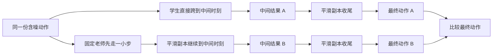

# CP的dropout改在哪里：计算路线与π0.5候选切口

2026-10-28，讨论与规划。未实现、未测试、未启动CP new，现有训练和续训队列未动。

## 先看当前CP怎样算一次一致性误差

下面的“走一步/收尾”都是网络内部从噪声生成动作的计算，并非机器人先执行一段再回退。平滑副本（EMA）是学生权重的缓慢平均，用来提供较稳的目标；不是额外训练出的更强老师。

本地`losses.py::cp_loss`中：老师先得`xu`；目标分支EMA `u→s→0`；预测分支学生`t→s`、EMA`s→0`。目标分支不反传；预测分支仍要通过EMA对输入的导数把学习信号传回学生。EMA权重不更新，不意味着可以把预测分支整体放入no_grad。

## 为什么论文特别检查收尾阶段

示意：中间A=0.4、B=0.6，收尾网络却都输出约0.5；最终误差很小，未必反映中间两条生成路线已经一致。这只是说明信号可能被压缩，**不证明两个相同的好动作有问题，也不证明越大loss越好**。

CP作者提出收尾映射可能使一致性信号过小，研究了该段dropout：Square消融中只取消`s→0`阶段dropout，成功率由92±2降到86±3。这个证据支持检查收尾阶段，不意味着给π0.5加扰动就能复现提升。见[原文IV-D、表IX](https://arxiv.org/html/2405.07503v2#S4.SS4)。

## dropout究竟改了什么

它作用于网络计算中的隐藏特征：

`一层算出的内部特征 → 随机把其中一部分临时置零 → 其余特征按1/(1-p)缩放 → 下一层`

`p=0.2`表示每个被作用的特征有20%概率被置零。每次调用通常换一份随机选择；它不删权重、不删20%动作、不增减去噪步数。评估时关闭这项随机扰动。

在CP里，收尾网络每次不能完全依赖同一小部分内部特征，学生需要在这些训练期变化下仍产生一致的最终动作。作者用它来改善学习信号；随机误差本身并不保证形成有益梯度，还需要看训练效果。

## 原版与我们的网络不一样

|位置|原版CP实际代码|我们的当前π0.5|拟议适配，未执行|
|---|---|---|---|
|特征扰动模块|U-Net残差块：第一卷积块后一次，残差合并后一次|Gemma动作专家没有对应dropout模块|在动作专家MLP输出、进入门控残差前接局部dropout|
|收尾阶段|EMA调用同类网络，因此可有dropout|目前EMA计算确定，无对应模块|显式使训练期EMA收尾也启用局部扰动|
|学生训练的其他调用|同一学生网络也含模块|当前无|是否连同FM和中间映射一起启用，作为单独范围选择|
|固定老师/视觉语言部分/实际评估|教师冻结并eval；评估关闭dropout|沿用已验证冻结前缀|保持关闭|

固定源码：CP `eed0c465d3c1aa6dcf22f10e784df07dec06beac`，[模块位置](https://github.com/Aaditya-Prasad/consistency-policy/blob/eed0c465d3c1aa6dcf22f10e784df07dec06beac/consistency_policy/diffusion_unet_with_dropout.py#L47)、[0.2配置](https://github.com/Aaditya-Prasad/consistency-policy/blob/eed0c465d3c1aa6dcf22f10e784df07dec06beac/configs/ctmp_square.yaml#L62)、[两路收尾](https://github.com/Aaditya-Prasad/consistency-policy/blob/eed0c465d3c1aa6dcf22f10e784df07dec06beac/consistency_policy/ctm_policy.py#L473)。

源码名`scale_dropout/bias_dropout`不等于只扰动FiLM系数；实际被置零的是隐藏特征。π0.5的MLP输出位置是可操作的Transformer候选，**不是原论文证明过的逐层等价位置**。不能把p=0.2在不同层上的影响强度当作完全相同。

## 为什么当前版本没有，未来如何限定改动

首次移植沿用了已跑通π0.5的`model.eval()`和前缀复用，迁入CTM/EMA/损失时没有逐项核对原版dropout。这是适配审计遗漏，没有“已验证不需要”的依据。但也不意味着补上任意位置的dropout必然正确。

当前安装版联合前向直接调用动作专家MLP，可能绕过DecoderLayer完整forward；因此未来不能只给大层注册钩子、看到配置就宣称生效。应只在本项目包装里挂实际调用的动作专家MLP，不改共享OpenPI安装包，不对整个模型粗暴调用train。

未来若获实施决定，只需少量针对性验证：p=0复现旧前向；p>0实际生效；教师/视觉前缀/评估无扰动；EMA预测分支能向学生传梯度；梯度重算与完整恢复保留随机状态。不会为此预先重写模型或增加仿真采集。

## 本轮收敛到的讨论点

1. **mask是“哪些输出算错”，dropout是“内部怎样计算输出”。** 两个改动相互独立。
2. mask候选见17：两项都14，或一致性14/FM32；不再称全32是确定错误。
3. dropout可从覆盖原CP训练分支的方案考虑；若要定位论文提出的收尾机制，也可只扰动EMA的`s→0`两次调用。范围不同必须写清，不能混称复刻原版。
4. p=0.2是原CP配置给出的起点；动作专家MLP位置是我们的结构适配。模型、数据、H50、学习率、并行与评估沿旧版；未授权实施前不把这些候选下发。

本轮保留方案，等用户充分理解后再定；不增加新队列。
