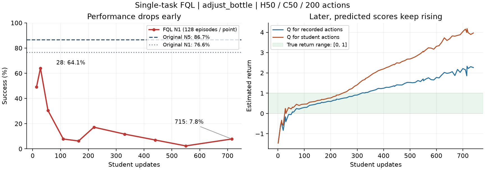

# 单任务FQL：先把评分器学准，再让它指导策略

2026-10-28。单任务FQL已按用户要求停止；本页是诊断与修复规划，没有启动修复版FQL。

后续核对见[25 原FQL差异、梯度比例与Q可信度](25_FQL_COMPARISON_AND_Q_MEASUREMENT_20261028.md)：原FQL也从随机Q联合启动；首批19倍不是全程比例，后期已约1；原基准与本任务的奖励尺度不同。

## 看到了什么

同一adjust_bottle、H50/C50、200动作协议，原始N5为111/128=86.72%，原始N1为98/128=76.56%。FQL最高点28为82/128=64.06%，55点降至30.47%，110点7.81%；715点仍10/128=7.81%。停止时训练到740，最后完整恢复点715、最佳完整点28都保留。

图左是实际执行成绩，直线只连接测量点；右为rank0训练批次估值，不是独立评估。训练损失降低不能代替执行成功率。

|证据|实测|说明|
|---|---|---|
|数据量|128条完整执行，115成功、13失败；仅405个动作块转移|短链最多4块，数据比“128回合”听起来稀疏|
|重复量|全局batch448；740步累计约818.6次转移曝光|是同一小批记录反复学习，没有持续采新环境数据|
|开始时的指导|第一步Q动作梯度RMS约8.60e-5，已乘α的蒸馏约束约4.55e-6，约18.9倍|局部输出梯度诊断，支持随机Q过早主导的疑点；不是整网参数梯度比例|
|后期估值|740点数据动作Q=2.263，学生动作Q=3.968|该有限任务真实折扣回报在0–1内，已明显失准|
|早期退化|110点已7.81%，相邻111步数据动作Q仅0.319、学生动作Q约0.482|成功率崩溃早于整体Q超过1，后期高估不是全部原因|

单任务也出现明显退化，所以不能再把多任务干扰作为主要解释。它仍可能影响旧多任务实验，但不能解释本次单任务失败。

## 数据与实现查到了哪里

只读检查全部128条H5的小数组：首次成功奖励仅一次、成功/预算末端bootstrap为0、前后观察数和动作边界连续、remaining及mask与已提交块长相符，均通过。记录中的预测动作是模型归一化坐标，Q和蒸馏使用真实14维；没有把18维填充计入FQL学生损失。未发现这几类数据拼接错误，不等于已经排除所有适配问题。

每次更新仍是：读转移 → 用学生产生下一状态动作 → 目标Q给出学习目标 → 当前Q拟合 → 学生同时接受老师端点约束与当前Q指导 → 各更新一次 → 目标Q慢更新。老师与视觉语言部分冻结。代码的`warmup_steps=55`只是学生学习率从小升高，**不是让Q先学55步**。

双Q为4层512宽、LayerNorm，学习率3e-4；目标Q系数0.005、折扣0.99、两头取平均；学生最高2.5e-5再衰减，α=10。模型/动作接口继承直接蒸馏，Q及目标形式来自官方FQL。官方默认也允许取平均，因此“没取min”本身不构成实现错误。

重要适配差异：官方主要在较低维动作上同时学习行为流、学生和Q；我们固定已有π0.5老师，学生从已有能力的N1策略起步，Q却从随机开始，Q需评分一整块50×14=700个动作坐标，并使用冻结VLM平均特征。405条数据是否足以支撑这类动作评分、平均特征是否保留精细成功信息，目前没有实证保证。

另有动作范围差异：官方代码把Q查询动作剪至[-1,1]；本次原生有效数据有4.75%坐标绝对值超过1，最大1.269。因此不能把同样的剪裁数值直接搬来；需按原生归一化与执行转换核对有效动作范围。当前未记录学生越界率，应作为修复版诊断补齐。

## 原FQL为什么没有Q预热

[原论文Algorithm 1](https://arxiv.org/html/2502.02538v2#S3)与[官方主循环](https://github.com/seohongpark/fql/blob/e8cd16eb490332924dfa2492097219f181765933/main.py#L105)从开始就联合更新，未规定critic-only阶段。缺少Q预热不是漏抄原方法；但原设置有效，也不能保证“预训练大策略＋随机Q＋405条高维转移”的适配同样稳定。

直观地说：学生已会一些动作，而评分器刚上岗。现在从第一步就让学生争取更高评分，可能先学会迎合评分器的错误，而不是完成任务。后面Q还会用“下一状态自己的预测”当学习答案，错误可能相互支撑；只把这个过程提前多跑几百次，不保证答案更准。

其他实现也要分开读：

- [官方FQL当前README](https://github.com/seohongpark/fql#tips-for-hyperparameter-tuning)建议新环境优先考虑Q损失归一化并调α；归一化控制指导尺度，不能让错误的动作排序变正确。
- [一个非官方PyTorch实现](https://github.com/MohammadrezaNakhaei/FQL/blob/main/fql.py#L43)逐轮更新Q、行为流和学生，也没有独立预热阶段；它用于教学/小型基准，不能当作π0.5适配已验证。
- [CFP作者仓库](https://github.com/Daoyi-Li/CFP#fql)给出加载预训练actor后预热critic的FQL配置，说明这种训练顺序有相关先例；它是在线微调场景，不能把10000步直接当作我们405条离线数据的合理预算。

本轮ReinFlow固定文件的网页和raw入口未成功返回正文，不把此前记忆当作本轮重新核验的证据。

## 建议怎样修，先做哪个

优先做一个切口清楚的修复对照：**学生先固定 → Q先学并检查 → Q指导从小逐渐增加**。保持当前π0.5、任务、数据接口和评估种子，避免同时换一串无关参数。

1. 从完整轨迹计算真实折扣回报，按整条轨迹留出一部分，检查Q校准而不只看训练损失。可把这些回报用于Q初始化，避免一上来完全依赖自己的预测。
2. 必须标明真实回报来自采集老师N5；它可初始化老师行为的Q，并不等于另一学生策略的Q。学生改变后仍需价值更新与执行检查。固定学生、使用学生下一动作做预热也可作为更贴近FQL的对照，但仍有分布外估值风险。
3. Q开始参与学生更新时，用逐渐增加的Q项系数保留蒸馏约束；记录Q项/蒸馏项的动作梯度、数据与学生Q、超过真实上限的比例和实际成功率。α是否需更大由这些量决定，不照抄10。
4. 若留出轨迹上评分仍不可靠，优先补弱策略/学生的失败与恢复行为数据，再考虑更复杂Q网络；现有13条失败覆盖很薄。扩大样本或改变评分器需另记为下一轮变量。

本轮没有足够证据指定唯一最佳预热步数，也不建议仅把Q更新次数翻倍就直接长跑。先让小规模对照回答“评分是否可信、启用Q是否立刻伤害策略”，再确定正式预算。

数据证据：[精简原始日志与评估](../experiments/single-v2-queue-20261028/README.md)。实现：`train_fql.py`、`fql.py`、`transitions.py`、`model.py::prepare_fql`；未修改这些FQL源文件。
