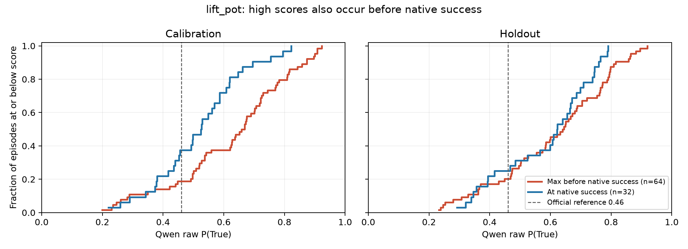
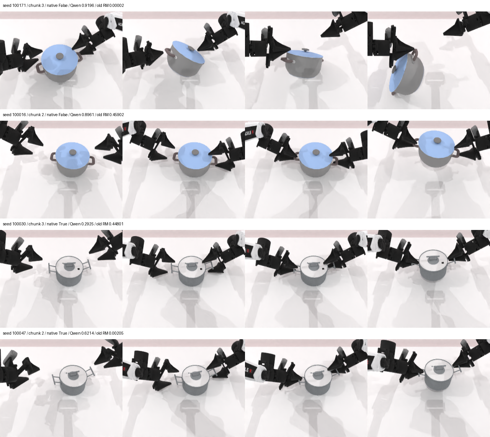

# 结论：当前TOPReward配置不放行训练

2026-10-21，深圳2物理4/5完成实现与离线验收，**中止当前奖励替换，不启动旧RM/Qwen短训练或200轮正式WMRL**。原因是过程中的提前成功误报，不能靠一个标量阈值修复；代码和数据证据保留。

128条原生lift_pot轨迹，999个过程窗口。按actual seed固定64条校准、64条留出，每边32成32败，输入与任务描述均沿用原生记录。阈值不利用留出集选择，0.46仅作为官方参考。

下表“提前报成功”按轨迹计：只要在原生尚未成功时有一次超过阈值，就计一条，包含最终成功的轨迹；不是最终失败率。“0/32召回”指判分器漏掉全部32个真实成功，并非机器人实际成功率为0。通俗解释和RLinf其他VLM路线见[07 对照](07_EXPLANATION_AND_VLM_COMPARISON.md)。

后续[08 分布分析](08_SCORE_SEPARATION.md)单独检查连续排序用途：终点分数有一定成败区分，但过程聚合不稳定且有长度影响。本文暂停的是当前二元成功/早停接法，不据此否定所有连续奖励对照。

| 判分与集合 | 提前报成功的轨迹 | 原生成功窗口检出 |
|---|---:|---:|
| Qwen，0.46，校准 | 52/64＝81.25% | 20/32＝62.5% |
| Qwen，0.46，留出 | 51/64＝79.69% | 24/32＝75.0% |
| 旧RM，0.8137992，本次留出（含旧训练样本） | 0/64 | 19/32＝59.38% |
| 旧RM，原有独立test子集 | 0/16 | 2/8＝25.0% |

成功窗口检出是离线诊断，不是闭环任务成功率；上线后更早的误报会终止轨迹。旧RM独立子集漏掉6/8个真实成功，确有漏判证据；该样本很小，召回95% Wilson区间约7.1%–59.1%，不能据此把旧训练的全0奖励全部归因于RM。完整计数和区间见[report](evidence/native-report.json)。

校准集零提前误报所能达到的最佳成功召回为**0/32**（阈值至少约0.9227641）；若要求召回≥50%，最少仍会误报**45/64＝70.31%**。因此不是“把0.46调高一点”即可解决。实际调用确认16帧完整输入，使用官方原提示词和全词表下一token ` True` 概率，未做True/False二次归一化。

## 原生判据与可见失败

现场`lift_pot.check_success()`同时要求锅高度>0.82 m、左右TCP各距对应抓取点<0.03 m、锅朝向与竖直方向点积>0.8。来源：[原生任务源码](reference/lift_pot.py)，服务器`/data/chenyiteng/projects/rlinf-shenzhen/RoboTwin-RLinf-support/envs/lift_pot.py`。

留出seed100171第3块中锅明显倾斜、单侧牵引，native为失败，Qwen仍给0.9196，旧RM约0.000021。seed100030在原生成功时Qwen仅0.2925；旧RM独立test的seed100047在原生成功时仅0.00205。已按同一episode和确切评分窗口核对样例。不能从单张2D画面精确反推出每条轨迹具体违反哪项3D判据；数字真值仍来自原生环境。

每行展示同一评分窗口的4个采样帧，行内标注seed、块、native标签、Qwen/旧RM分数。实际输入仍为完整≤16帧。帧引用和窗口索引见[examples](evidence/examples.json)，不是用这4帧重新评分。

## 资源、测试与实现边界

全量评分116.4秒，其中VLM前向与预处理100.4秒；不含约50秒的模型初始化/载入。单个16路管道请求3.03秒，内部为16次串行视频前向；Qwen峰值分配16.62 GiB、保留17.10 GiB，载入37.75秒、卸载11.23秒，卸载回执0个非CPU参数/缓冲区，子进程正常退出。单次实测受同机负载影响。[B16证据](evidence/b16-report.json)。

8项CPU测试、新脚本Ruff、真实处理器和GPU评分/进程卸载均通过。环境持有逐槽视频历史，支持reset与get_state/set_state，B16拆分和活跃槽缩减不串帧；判定只能归于完整C32块末。旧ResNet分支保留，TOPReward默认不启用。

**未完成也未声称完成**：WM与Qwen共同驻留的整链B16测试、生成视频真值检查、GRPO短对照、正式训练。这些阶段因原生标定失败而不放行。没有继续迁移大体积WM资产或改动WM/策略预算。

下一切口应先对齐原生成功定义与视觉判分，重点覆盖倾斜、单侧提起、未达到高度及抓取位置偏差的负例。若另改提示词、视角或训练奖励模型，应作为新版本，重新划分或补充留出数据；不能在本次已查看的留出集上反复调到通过。当前结论只针对本轮配置和lift_pot，不推广为Qwen/TOPReward在所有任务上无效。

## 可复查产物

- [原始逐窗口分数](evidence/native-scores.jsonl)、[冻结数据划分](evidence/native-manifest.json)、[阈值诊断](evidence/native-analysis.json)。
- [精确执行argv](evidence/offline-plan.json)、[模型环境](evidence/qwen-environment.json)、[CPU测试](evidence/cpu-tests.txt)、[帧处理证明](evidence/processor-check.json)。
- [C20收束](05_C20_CLOSEOUT.md)与旧扫描轻量结果；原始视频/NPZ、模型权重及大日志留服务器，不随Git发布。
