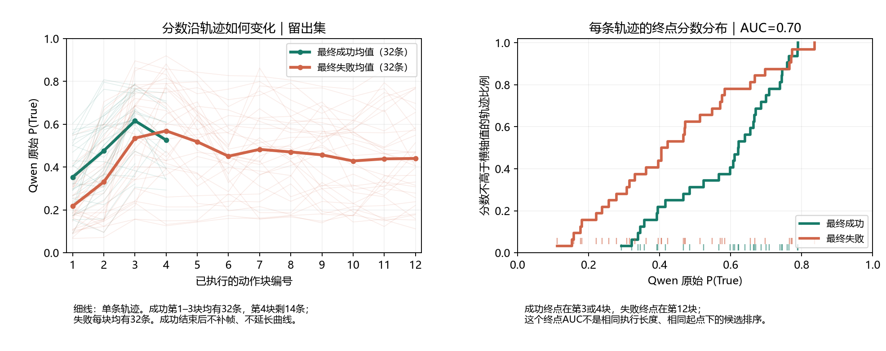

# TOPReward作为排序信号：现有轨迹分布

2026-10-21。用户要求简要检查过程分布与成败区分，不把成功早停裁判的标准直接当成所有奖励信号的标准。本轮仅重算已有128条原生轨迹、999个窗口，没有新模型推理或训练。

**结论修正：当前配置不能直接承担成功奖励与提前终止，但确有一些轨迹间排序信息；连续奖励仍值得小对照验证。现有数据不能证明这些信息足够驱动策略改善。**

## 数值

AUC表示随机抽一条成功、一条失败时，成功分数更高的概率；同分计一半。0.5为随机排序，低于0.5为方向相反。它不是阈值准确率。每个拆分均32成功、32失败；所有指标均为看过数据后的描述性分析，不据此选择最好的指标并宣称新的独立验证。

| 取哪种分数，每条轨迹一个值 | 校准AUC | 留出AUC | 留出成功/失败均分 |
|---|---:|---:|---:|
| 第一块执行后的分数 | 0.699 | 0.756 | 0.353 / 0.218 |
| 轨迹终点分数 | 0.629 | 0.701 | 0.584 / 0.440 |
| 前三块均分 | 0.528 | 0.711 | 0.482 / 0.361 |
| 全轨迹均分 | 0.445 | 0.571 | 0.490 / 0.445 |
| 全轨迹最大值 | 0.239 | 0.393 | 0.627 / 0.658 |
| 末块减第一块 | 0.528 | 0.516 | 0.231 / 0.223 |

留出终点AUC的分层逐轨迹bootstrap描述性95%区间约0.56–0.83；校准约0.48–0.77。第一块是在执行动作之后，不是reset状态，首尾差也不是从reset算的进展。

## 分数在过程中如何变化

留出成功轨迹前3块均值0.353→0.476→0.616；失败轨迹0.218→0.331→0.535，第4块到0.569，此后大体下降至末块0.440。**失败也会升分，成功并非一路升分。** 留出32条成功中，有16条最后成功块的分数低于上一块；全128条中的64条成功里有33条如此。

留出成功18条在第3块结束、14条在第4块结束，失败32条全部跑到第12块。图中后期成功曲线不补帧、不重复末分；第4块成功均值只来自仍在运行的14条，不能当作原32条的共同变化。校准成功另有1条到第10块才结束。

因此终点成败区分包含不同执行长度及终止时刻的影响。共同第3块的AUC只有校准0.435、留出0.585；前三块均分在两拆分间也不稳定。最后成功块可能不足完整C32，不能把这些按块比较说成严格相同物理时刻比较。

如果直接把每块原始概率相加，留出成功累计均值1.676、失败5.339，存在明显长度偏置。取全程最大值也让长失败轨迹拥有更多拿到高分的机会。不能据终点AUC尚可，推断任意聚合方法都适合训练。

## 对训练的含义

用户提出的区分是成立的：**带噪但方向正确的排序信号，不必达到可靠成功早停裁判的精度，才可能有训练价值。** 原先零提前误报的门槛只验证本次0/1成功奖励与早停接法，应保留这个范围。

当前实际GRPO是G8组内比较，并启用原二元奖励的组过滤。本批原生数据的128个actual seed互不重复，没有同一起点的8条候选；全局AUC不能直接证明同组动作优劣有稳定排序。第一块已有较强相关性，后续增量接近随机，也提示需区分初始条件/早期行为差异与可用于改善后续动作的信号，尚不能确定是哪一种占主导。

若继续，合理的小对照是：先把VLM连续评分与成功终止分开，在相同起点和可比较执行预算下检查候选排序及原生结果；再选明确的回报聚合并核对现有G8过滤。不能沿用“报True就结束”，也不宜直接累加每块原始概率。此处提出对照方向，没有声称当前终点AUC已证明固定时域连续奖励有效。

完整数值与逐块样本数：[score-separation.json](evidence/score-separation.json)。图的[矢量PDF](evidence/score-separation.pdf)。复算入口：`local_scripts/topreward_20261021/analyze_score_separation.py`，只依赖已有分数、NumPy和Matplotlib。
